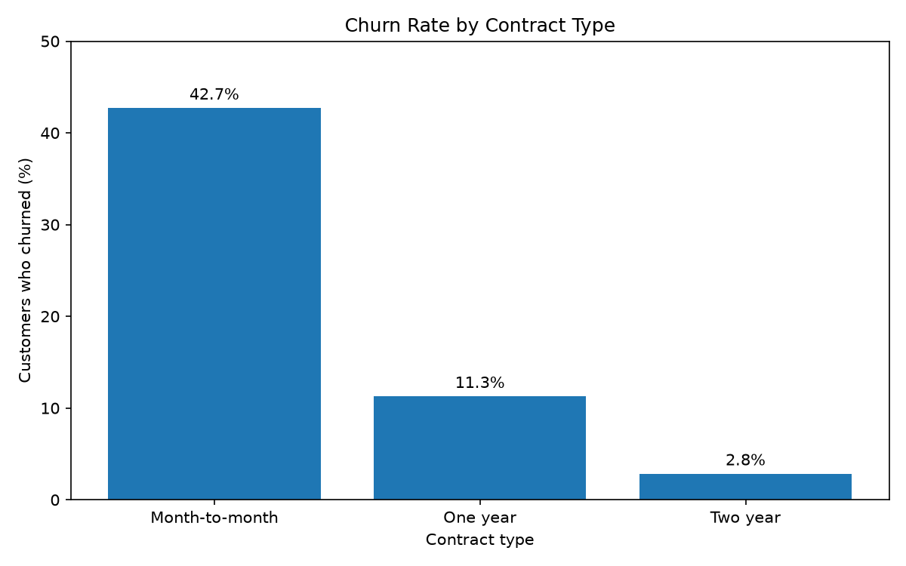
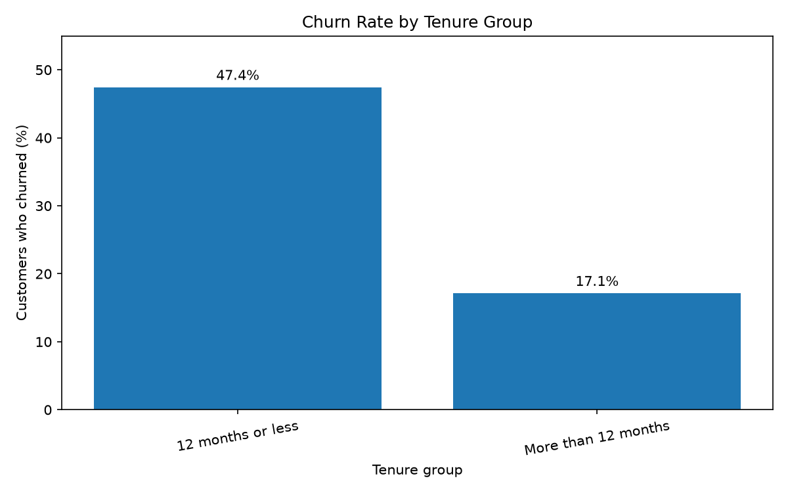

# Telco Customer Churn — Exploratory Data Analysis

This project explores customer churn in the Telco Customer Churn dataset using Python, NumPy, Pandas, and Matplotlib. It summarizes churn patterns, documents a small data-cleaning decision, and generates two charts.

## Business Problem and Objective

Customer churn is relevant to customer retention and recurring revenue. This analysis describes how churn varies across monthly charges, contract types, customer tenure, and payment methods. It is an exploratory summary, not a causal analysis or a model for predicting individual churn.

## Dataset Source and Attribution

The [Telco Customer Churn listing on Kaggle](https://www.kaggle.com/datasets/blastchar/telco-customer-churn), uploaded by BlastChar, describes the data as IBM sample data and displays the license wording “Data files © Original Authors.” That wording does not establish permission to redistribute the CSV. The CSV is therefore excluded from Git until redistribution permission is confirmed.

The dataset contains customer, service, account, billing, and churn fields. This analysis was run locally against a CSV with 7,043 records and 21 columns. The CSV is not included in the public project by default.

## Technologies

- Python
- NumPy
- Pandas
- Matplotlib

## Repository Structure

```text
Milestone_01_NumPy_Pandas_EDA_Capstone/
├── .gitignore
├── README.md
├── requirements.txt
├── data/
│   └── README.md
├── images/
│   ├── churn_by_contract.png
│   └── churn_by_tenure_group.png
└── notebooks/
    └── telco_customer_churn_eda.py
```

The dataset CSV is stored locally at `data/WA_Fn-UseC_-Telco-Customer-Churn.csv` when running the script, but excluded from Git. The `notebooks/` folder contains a Python script, not a Jupyter notebook.

## Analysis Workflow

1. Load the CSV from the project-relative `data/` path.
2. Review the dataset shape, sample, column types, missing values, and duplicate rows/customer IDs.
3. Summarize churn and monthly charges.
4. Compare churn rates by contract type, tenure group, and payment method.
5. Save the contract and tenure charts to `images/`, and display them when an interactive Matplotlib backend is available.

## Data Cleaning and Assumptions

`TotalCharges` is read as text because the CSV contains 11 whitespace-only values. The script converts the column to numeric with `pandas.to_numeric(..., errors="coerce")`, then verifies that these are the only values that failed conversion and that all 11 rows have zero tenure. It fills those entries with zero so the records remain in the analysis. This is a reasonable assumption for customers with no recorded tenure, but it is not verified billing history. The script raises an error if the blank count or zero-tenure condition differs from what was checked, or if any `TotalCharges` values remain missing after the fill. It does not drop customer records.

## Findings

The following values are calculated from this dataset and rounded to two decimal places:

1. **Overall churn:** Approximately **26.54%** of customers have `Churn = Yes`.
2. **Monthly charges:** Average monthly charges are approximately **$74.44** for churned customers and **$61.27** for retained customers. This is an observed difference, not evidence that higher charges cause churn.
3. **Contract type:** Churn is **42.71%** for month-to-month, **11.27%** for one-year, and **2.83%** for two-year contracts. These rates show an association between contract group and churn in this dataset, not a causal effect of contract length.
4. **Customer tenure:** Churn is **47.44%** for customers with 12 months or less of tenure and **17.13%** for customers with more than 12 months. The difference makes early customer retention a useful area for further investigation; it does not establish why the groups differ.
5. **Payment method:** Electronic-check customers have an observed churn rate of approximately **45.29%**, the highest among the payment-method groups.

All findings are descriptive associations for this dataset. They do not establish that charges, contract type, tenure, or payment method cause churn.

## Visualization Previews

### Churn Rate by Contract Type



### Churn Rate by Tenure Group



## Installation and Execution

Use Python 3.10 or later. From the project root, create and activate a virtual environment and install the required packages:

```powershell
py -m venv .venv
.\.venv\Scripts\Activate.ps1
python -m pip install -r requirements.txt
```

On macOS or Linux, create and activate the environment, then install the packages:

```bash
python3 -m venv .venv
source .venv/bin/activate
python -m pip install -r requirements.txt
```

Before running the analysis, obtain the dataset from the [Kaggle source listing](https://www.kaggle.com/datasets/blastchar/telco-customer-churn) and follow its terms. Place the downloaded file at:

```text
data/WA_Fn-UseC_-Telco-Customer-Churn.csv
```

The `data/README.md` repeats these local setup and redistribution notes. Run the script from the project root:

```bash
python notebooks/telco_customer_churn_eda.py
```

The script also resolves data and image paths relative to its own location, so it does not require the project root to be the current working directory. It prints summaries and writes the two charts to `images/`.

## Limitations and Future Improvements

- The results describe one dataset and may not generalize to other providers or periods.
- Group comparisons do not control for overlapping customer characteristics and cannot identify causes.
- Tenure is divided at a single 12-month cutoff; other descriptive groupings may be useful.
- Confirm and document redistribution permission before committing the CSV. Further work could explore other existing service attributes or use appropriate statistical methods, while keeping claims descriptive unless the study design supports stronger conclusions.
